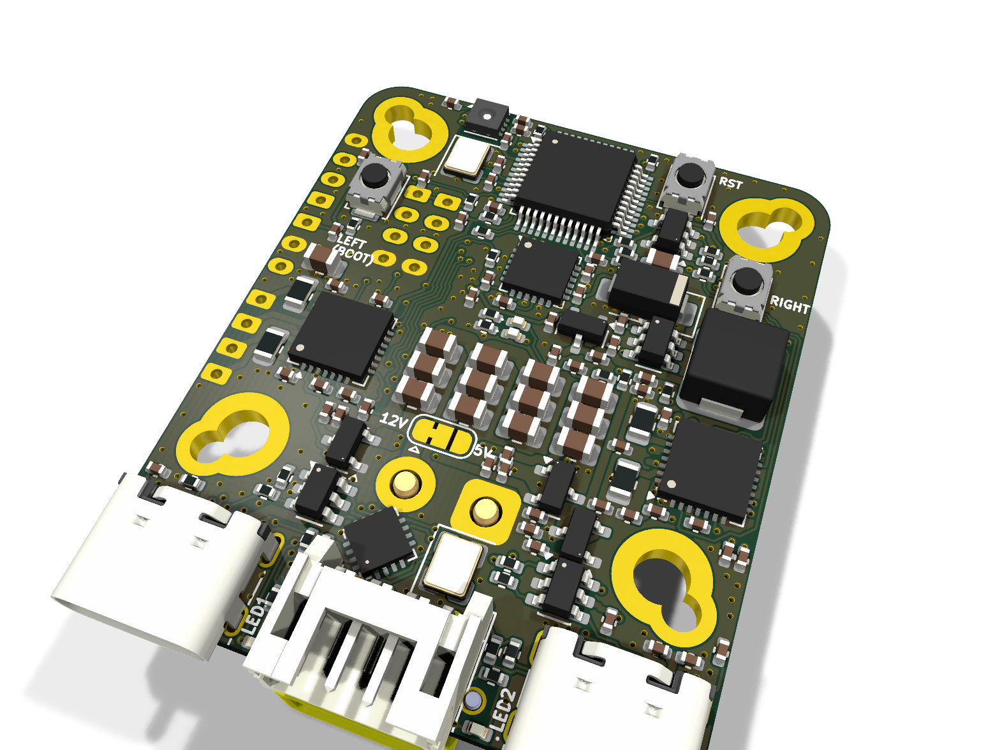
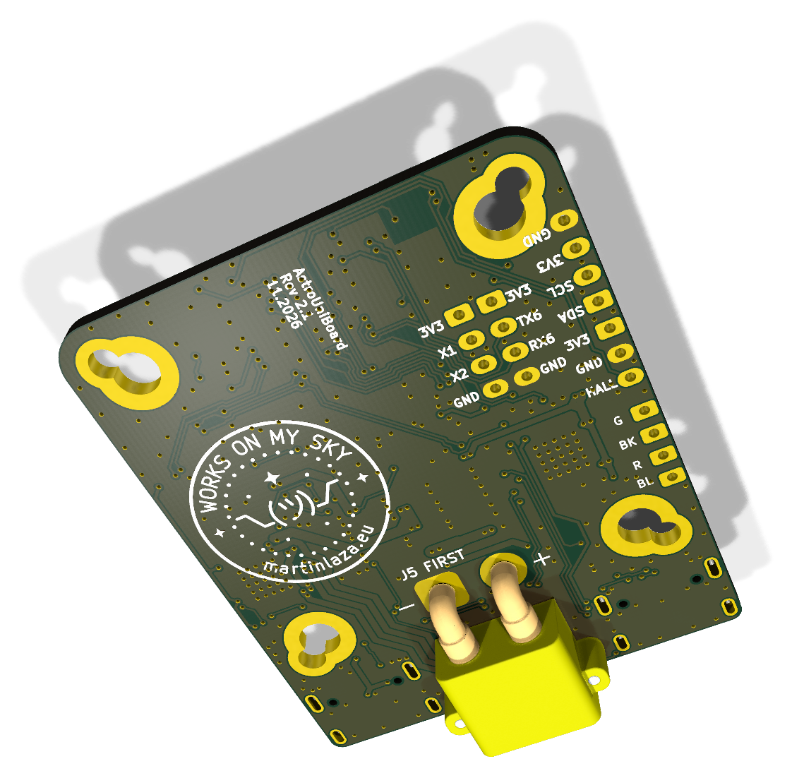
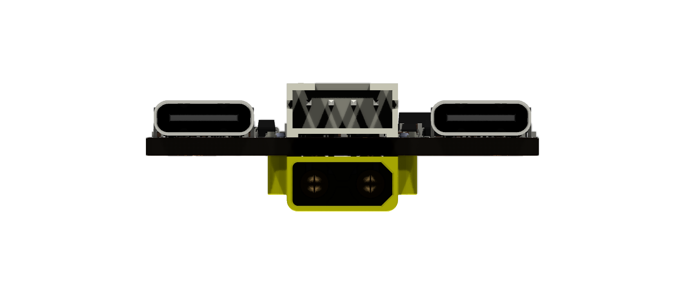
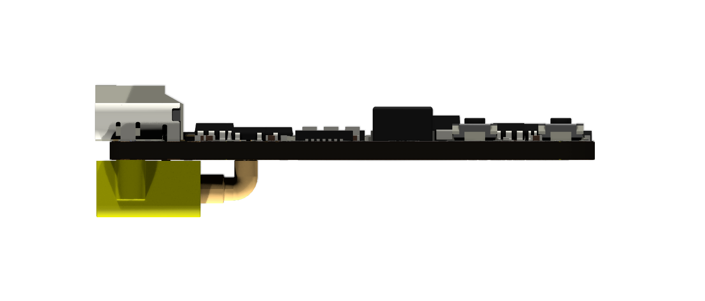
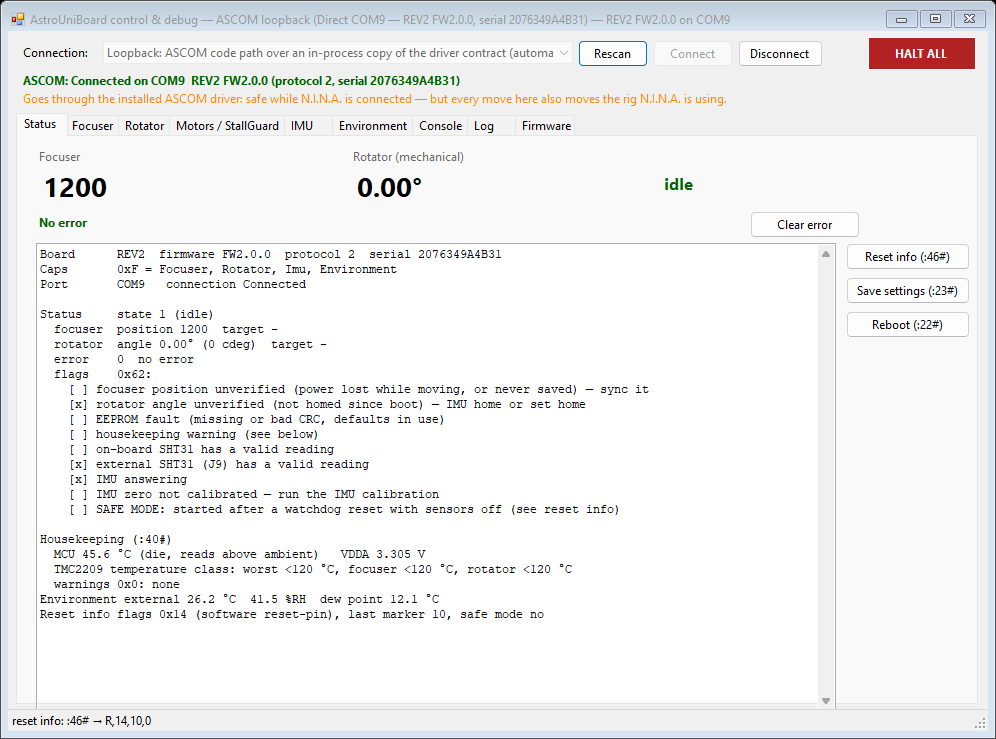
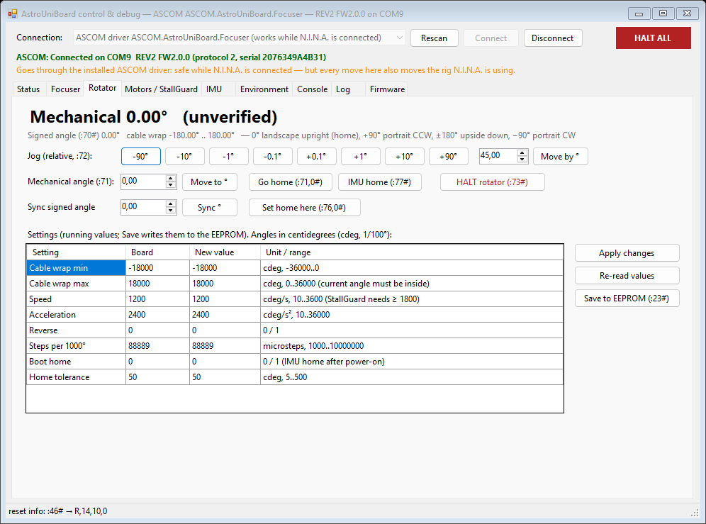

# AstroUniBoard

A small (35 × 42 mm) STM32G0B1 controller for the **imaging train**. It drives a focuser and a camera rotator, reads
temperature, humidity and camera roll, and has a USB hub, so the camera's USB cable runs through the board.
It is built to sit on the moving part of the train and rotate with the camera, so only one USB cable and one 12 V
cable leave the rotating side.

<p align="center">
  
  
</p>

| | |
|---|---|
| Status | Release [v2.0.0](https://github.com/xlazam01/AstroUniBoard/releases/tag/v2.0.0): HW rev 2.1, firmware V2 `2.0.0`, protocol 2. Current ASCOM driver [0.2.1](https://github.com/xlazam01/AstroUniBoard/releases/tag/driver-v0.2.1) (pre-release). Firmware 2.0.0 is not yet tested on a rev 2.1 board. **HW rev 2.2** (SHT40 on the board + snap-off SHT40 sensor tab) is designed, not ordered; it needs firmware with SHT4x support (PR #91) |
| MCU | STM32G0B1CBT6, Cortex-M0+ 64 MHz, 128 KB flash, 144 KB RAM |
| Motors | 2 × TMC2209 (UART, StealthChop / SpreadCycle, StallGuard), up to 1.5 A RMS each (firmware limit) |
| Sensors | SHT40 temperature/humidity on board (+ a second SHT40 on a snap-off tab for outside the board), MPU-6000 accelerometer for camera roll |
| Host | USB-C, CDC serial, VID/PID 1209:0001 (pid.codes test PID until our own is assigned) |
| Hub | CH334P, one downstream USB-C for the camera (or a guide camera, or any other device) |
| Power | 12 V on an XT30 (motors + 5.3 V buck). Logic also runs from USB alone, without motors |
| Licences | firmware and software GPL-3.0, hardware CERN-OHL-S-2.0 |

Renders are from KiCad and show the board as JLC delivers it (DNP sockets left out).
Schematic: [docs/astrouniboard-rev2.1-schematic.pdf](docs/astrouniboard-rev2.1-schematic.pdf).

---

## Contents

- [What is on the board and why](#what-is-on-the-board-and-why)
- [Other applications](#other-applications)
- [Alternatives considered](#alternatives-considered)
- [Connectors and jumpers](#connectors-and-jumpers)
- [Bill of materials](#bill-of-materials)
- [Assembly](#assembly), including **[the J5 / XT30 order](#1-j5-before-j6-the-xt30--read-this-first)**
- [First power-up](#first-power-up)
- [Firmware](#firmware)
- [Host software](#host-software)
- [Repository layout](#repository-layout)

---

## What is on the board and why

| Feature | Part | Why it is there |
|---|---|---|
| **Two identical motor channels: focuser and rotator** | 2 × TMC2209 (U3 focuser, U2 rotator), same parts and 0.11 Ω sense on both | The same driver circuit twice, so either channel can take either job, and one BOM line covers both. **Focuser:** version 1 targets the **guide-camera focuser** behind an OAG, which N.I.N.A. cannot focus on its own (see the [Secondary Focuser plugin](https://github.com/xlazam01/SecondaryFocuser-NINA)); StallGuard can stop a move against a hard stop. **Rotator:** the firmware keeps the mechanical angle and never crosses the cable-wrap limits (default ±180°, configurable); the sky offset stays with the host. StealthChop keeps both silent and avoids vibration during exposures |
| **One UART for both drivers** | USART2, addresses 0 / 1 | Run current, hold current, microsteps and mode can be set at runtime and saved, with no pots to adjust. Driver faults, overtemperature and StallGuard are visible to the host |
| **Camera roll sensor** | MPU-6000 U10 (I²C, 0x68) | The board rotates with the camera, so the accelerometer measures camera roll against gravity. That gives **IMU homing**: the rotator finds its zero without a switch, flag or Hall sensor. Calibrate once (three captures, any mounting orientation, also upside down) |
| **Temperature / humidity** | SHT40-BD1B U8 (0x45; SHT31 on rev 2.0/2.1) | For temperature compensation of focus (done on the host) and for dew point (ASCOM ObservingConditions). It is on the board because the board sits on the optical train |
| **Switched sensor supply** | PB9 → R32 → SHT40 VDD | **Less self-heating:** the sensor sits on a board that warms up from the drivers and the buck, and a sensor that is powered all the time adds its own heat. Powering it only around a measurement keeps the reading closer to the air temperature, which matters for focus temperature compensation. (Firmware 2.0.0 still keeps it powered and uses the switch to power-cycle a stuck sensor; duty-cycling it is a firmware option for later.) The on-board SHT40-BD1B answers at 0x45, so the **external SHT40-AD1B** (0x44) fits on the same bus. (Rev 2.0 got the same split from an SHT31 with ADDR tied to PB9.) |
| **Snap-off sensor tab** (rev 2.2) | U15 SHT40-AD1B at the tip of a 4 × 10 mm tab on the left edge, one mouse-bite row | The board's own sensor reads the board, not the air. Snap the tab off with pliers, wire its pads to J9 (3V3/GND on top, SDA/SCL on the bottom) and put it where the air temperature matters, for example on the dew shield. No copper pour on the tab, so it carries little heat. It is part of the same PCB and is assembled with it, so there is no second board to order |
| **Position memory** | 24AA64 EEPROM U4 | Focuser and rotator positions survive a power cycle. A 256-slot ring with CRC spreads the wear (two writes per move). A move cut by power loss is detected and flagged "unverified" |
| **USB hub** | CH334P U6, USBLC6 ESD on both ports, CH213K current-limited switch on the downstream VBUS | One cable from the PC carries the board and the camera. The downstream port is protected against shorts and ESD. The hub is **USB 2.0 (480 Mbit/s)**: fine for a guide camera, but a USB 3 imaging camera loses speed on it and should get its own cable |
| **Power path** | XT30 J6 → F1 2 A polyfuse → D24 SMF15A TVS (rev 2.1) → ME3116 buck (5.3 V) → CH213K ideal-diode OR with USB VBUS → ME6231 3.3 V LDO | 12 V for the motors and a 5 V rail for the hub. D24 clamps the plug-in ringing of a long cable on the all-ceramic input capacitance to below the TMC2209's 29 V limit. F1 trips on a short or overload behind it and resets when cooled. There is no reverse-polarity FET: a reversed supply drives D24 forward until F1 trips, which may cost D24. Rely on the keyed XT30 and check home-made pigtails. The board also comes up from USB alone (bench work, firmware updates) while the motors stay unpowered. 5.3 V leaves headroom for the drop across the ideal diode and the downstream current switch |
| **12 V sense** (rev 2.1) | R33/R34 divider on PB10 | The firmware can see that motor power is missing or low before a move, instead of finding out from a driver that stops answering |
| **Motor supply jumper** | JP4, one 3-pad solder jumper `12V – Vdrive – 5V`, 12 V side bridged | 5 V motors can be used from USB power for light loads. One middle pad means only one source can be selected (rev 2.0 had two separate jumpers that could short 12 V onto 5 V), see [Assembly](#4-solder-jumper-jp4) |
| **Status LEDs** | D1 status (PB12), D2 activity (PB4), D3 = 12 V present, D4 = 5 V present | You can see power, motion and errors without a PC. The brightness is adjustable and the LEDs are dim, because the board sits next to a camera |
| **Buttons** | RST, LEFT (= BOOT0), RIGHT | RST and BOOT0 are for recovery. LEFT/RIGHT are not used by the firmware: in the Triton enclosure the board is mounted upside down and out of reach |
| **Spare I/O** | J4 Hall/index, J8 AUX1/AUX2, J9 I²C, J10 UART6 — all DNP | For other uses of the board (filter wheel index, dew heater MOSFET, GPS, SQM). See [docs/USE_CASES.md](docs/USE_CASES.md) |
| **Mounting** | 4 × M2 (29 × 29 mm) and 4 × M3 (26 × 26 mm), overlapping keyholes | Fits both standoff patterns used in the rig enclosures. The 26 × 26 mm M3 pattern is the **NEMA 14 hole pattern**, so the board also screws straight onto the back of a NEMA 14 stepper: ideal for a focuser motor or a small mount axis, with no bracket and the shortest possible motor cable |

Pin map and electrical details: [docs/HARDWARE.md](docs/HARDWARE.md).

## Other applications

The board is a general two-stepper controller with an IMU, a temperature/humidity sensor and a USB hub. Besides the
focuser + rotator it was designed for, these uses came up (details in [docs/USE_CASES.md](docs/USE_CASES.md)):

| Use | What it takes |
|---|---|
| **Dual focuser** (main + guide scope, or OAG guide camera) | Firmware only: both channels as focusers |
| **Filter wheel** | Firmware only: one channel drives the wheel, J4 Hall input as the index |
| **Motorised dust cap / flat panel** | Firmware only for the cap; the panel dimming needs PWM on AUX (J8) |
| **Small mount or star tracker** (barn door, camera-lens mount) | Both channels as RA/Dec, board mounted straight on a NEMA 14; the IMU helps with levelling. OnStepX-based, needs more flash (G0B1CC/CE) |
| **Telescope cover, roof or small dome shutter** | Light loads only (TMC2209, about 2 A peak) |
| **Mount / observatory monitor** | IMU for vibration, wind shake and "scope bumped" alarms; SHT40 for dew-point alerts |
| **Dew heater control** | PWM on AUX1/AUX2 to an external MOSFET, closed loop on the dew point |
| **GPS, sky quality meter, cloud sensor** | GPS on UART6 (J10); TSL2591 or MLX90614 on I²C (J9), as an ASCOM SafetyMonitor / ObservingConditions |
| **Non-astro** | Camera slider or pan/tilt for timelapse, microscope focus stacking, 3D-scan turntable, syringe pump or slow linear stage |

## Alternatives considered

These options were weighed during the design, with the reason for each decision. Most are recorded in more detail in
[docs/V2_PLAN.md](docs/V2_PLAN.md) §9 and [docs/adr/](docs/adr/).

| Topic | Chosen | Considered instead | Why |
|---|---|---|---|
| Firmware | Own small firmware V2 (`fw/`) | Keep the OnStepX port (`fw-onstepx/`) | OnStepX filled 93 % of flash and carried mount code and the LX200 dialect we never use. V2 uses 65 %. The OnStepX build stays for rev 1 boards and for users who want OnStep clients |
| Step generation | Hardware timer + STEP pin, exact step count | TMC2209 `VACTUAL` internal generator | VACTUAL loses the step count, and a focuser must know its position |
| Motion | One axis at a time (`ERR,8` while busy) | Both axes at once | One step timer, a simpler ISR, and there is no real need to focus and rotate at the same moment |
| Protocol | OpenWheel family `:NN…#` | LX200 / OnStep dialect | The host libraries (detection, transport, watchdog) are shared with OpenWheel. Every command gets an answer |
| Code sharing with OpenWheel | Copy & adapt | Common library or submodule | Only two devices so far; extract a library when a third one needs it ([ADR 0001](docs/adr/0001-shared-code-openwheel.md)) |
| Rotator homing | IMU gravity homing (optional at boot) | Hall sensor or limit switch on J4 | No extra parts on the rotating ring. J4 stays available for a Hall index |
| Focuser homing | None: soft limits 0…max, position kept in EEPROM, manual sync | Home switch or StallGuard homing | A focuser rarely needs a home position. Fewer moving parts and no slamming into the end stop |
| Temperature compensation | On the host (driver / N.I.N.A.) | In the firmware | The host knows the filter, the optics and the AF history. The firmware only reports the sensor data |
| ASCOM architecture | One LocalServer: Focuser + Rotator + ObservingConditions on one port | In-process DLLs | N.I.N.A., the debug app and the plugin can be connected at the same time |
| Network | USB only. Alpaca after 2.0 | Alpaca / Wi-Fi on the device | No ESP on the board. Keeps the device simple and the attack surface small |
| Power connector | XT30 (keyed, 15 A class) | 5.5/2.1 barrel jack (rev 1) | Barrel jacks fall out and short when they are plugged in. The XT30 is keyed against reverse polarity and locks firmly |
| Motor connectors | J5 horizontal JST-PH for the rotator, focuser wires soldered (J3 DNP) | Vertical JST-PH on both | Edge entry: the cable leaves in the board plane, next to the USB cables. The trade-off is the [stacking with the XT30](#1-j5-before-j6-the-xt30--read-this-first) |
| MCU | STM32G0B1CBT6 (128 KB) | G0B1CCT6 (256 KB), G0B1CET6 (512 KB), same pinout | V2 fits in 128 KB. The larger parts are drop-in replacements if stock or features need them (avoid the `…N` variants, they have a different pinout) |
| LEDs | 0402 red (Extended part at JLC) | 0603 (Basic part, one less Extended fee) | Space next to the USB ports. Could change in a later revision |
| Buttons as hand controller | Not used | Manual focus in/out on LEFT/RIGHT | Not reachable in the Triton enclosure |
| Rev 3 ideas | — | 2–3 PWM dew-heater outputs, switched 12 V, INA219 power monitor, SWD pads | Would make it a focuser + rotator + hub + power box. See [docs/USE_CASES.md](docs/USE_CASES.md) |

## Connectors and jumpers

<p align="center">
  
</p>

| Ref | Side | What | Pinout |
|---|---|---|---|
| J2 | top edge | USB-C **to the PC** (upstream, board + hub) | — |
| J7 | top edge | USB-C **to the camera** (downstream, hub port) | — |
| J5 | top edge, horizontal | **Rotator motor**, JST-PH 4 (S4B-PH-K) | 1 B2, 2 B1, 3 A1, 4 A2 |
| J6 | **bottom** edge, under J5 | **12 V in**, XT30PW-M (male pins on the board); F1 polyfuse and TVS D24 on top next to its pins | `+` / `−` marked on the bottom silkscreen. **Not reverse-polarity protected** |
| J3 | pads, DNP | Focuser motor (solder wires or a vertical JST-PH 4) | 1 B2 (G), 2 B1 (BK), 3 A1 (R), 4 A2 (BL): colours on the bottom silkscreen |
| J4 | pads, DNP | Hall / index input | 1 3V3, 2 GND, 3 HALL |
| J8 | pads, DNP | AUX GPIO | 1 3V3, 2 AUX1 (X1), 3 AUX2 (X2), 4 GND |
| J9 | pads, DNP | External I²C (the snap-off SHT40 tab at 0x44, or any I²C sensor) | 1 SDA, 2 SCL, 3 3V3, 4 GND |
| J11 | snap-off tab, left edge | Wire pads of the SHT40 tab (U15) | top: 3V3, GND; bottom: SDA, SCL → J9 1 SDA, 2 SCL, 3 3V3, 4 GND |
| J10 | pads, DNP | UART6 | 1 3V3, 2 TX6, 3 RX6, 4 GND |
| JP4 | top, between the XT30 pins | Motor supply (Vdrive), 3 pads `12V – Vdrive – 5V` | **12V side bridged** by default |

The motor pin order (B2 B1 A1 A2) matches common 4-wire NEMA cables. Check your motor's coil pairs with a meter:
a swapped pair makes the motor buzz instead of turning. It does not damage anything.

## Bill of materials

Rev 2.2, JLCPCB assembly. Every fitted part carries an `LCSC` field in the schematic, so the JLC fabrication toolkit
fills the BOM by itself. Snapshot 2026-11-06. Check stock before ordering, see the notes below the table.

| Ref | Qty | Value | Package | LCSC |
|---|---|---|---|---|
| U5 | 1 | STM32G0B1CBT6 | LQFP-48 | C2847904 |
| U2, U3 | 2 | TMC2209-LA-T | QFN-28 5×5 | C2150710 |
| U6 | 1 | CH334P USB 2.0 hub | LQFN-16 3×3 | C5373042 |
| U10 | 1 | MPU-6000 | QFN-24 4×4 | C92401 |
| U8 | 1 | SHT40-BD1B-R2 (0x45) | DFN-4 1.5×1.5 | C7461849 |
| U15 | 1 | SHT40-AD1B-R2 (0x44, snap-off tab) | DFN-4 1.5×1.5 | C2909890 |
| U4 | 1 | 24AA64T-I/OT | SOT-23-5 | C2061092 |
| U12 | 1 | ME3116AM6G buck | SOT-23-6 | C97643 |
| U1 | 1 | ME6231A33M3G 3.3 V LDO | SOT-23 | C2765181 |
| U11, U13, U14 | 3 | CH213K ideal diode / current-limited switch | SOT-23 | C5456874 |
| U7, U9 | 2 | USBLC6-2SC6 ESD | SOT-23-6 | C2687116 |
| Y1 | 1 | 8 MHz crystal (TAXM8M4RDBCCT2T) | 3225 | C400090 |
| Y2 | 1 | 12 MHz crystal (TAXM12M4RDBCCT2T) | 3225 | C164041 |
| L4 | 1 | 10 µH (IHLP2020BZER100M11) | IHLP-2020 | C844984 |
| D23 | 1 | SS34 Schottky | SMA | C8678 |
| D24 | 1 | SMF15A TVS (12 V input) | SOD-123FL | C123802 |
| F1 | 1 | Polyfuse 2 A hold / 3.5 A trip, 16 V (Ruilon SMD1206P200TF/16) | 1206 | C55125664 |
| D1–D4 | 4 | LED red | 0402 | C130719 |
| J2, J7 | 2 | USB-C receptacle (G-Switch GT-USB-7010ASV) | THT/SMD | C2988369 |
| J5 | 1 | JST S4B-PH-K, horizontal | THT | C265452 |
| J6 | 1 | Amass XT30PW-M | THT, **bottom** | C431092 |
| RST1, LEFT/BOOT1, RIGHT1 | 3 | TS-1088-AR02016 | SMD | C720477 |
| C2, C3, C13, C16, C36–C44 | 13 | 22 µF 25 V | 0805 | C45783 |
| C29 | 1 | 10 µF 25 V | 0805 | C15850 |
| C24, C28, C31, C32, C45–C47, C53, C59–C66 | 16 | 10 µF 10 V | 0402 | C315248 |
| C14, C48–C51 | 5 | 10 µF 6.3 V | 0402 | C15525 |
| C1, C10, C11, C33 | 4 | 1 µF | 0402 | C52923 |
| C19–C23, C25–C27, C30, C56 | 10 | 100 nF 50 V | 0402 | C307331 |
| C6, C8, C9, C12, C15, C17, C34, C35, C52, C54, C55, C58, C69, C70, C71 | 15 | 100 nF 16 V | 0402 | C1525 |
| C7, C18 | 2 | 22 nF 50 V | 0402 | C1532 |
| C57 | 1 | 2.2 nF 50 V | 0402 | C1531 |
| C4, C5 | 2 | 10 pF | 0402 | C32949 |
| R10, R11, R19, R20 | 4 | 0.11 Ω (sense) | 0805 | C5126077 |
| R3, R4, R5, R9, R13, R15, R22, R24, R34 | 9 | 10 kΩ | 0402 | C25744 |
| R6, R7, R8, R14, R16, R17 | 6 | 5.1 kΩ | 0402 | C25905 |
| R21, R33 | 2 | 100 kΩ | 0402 | C25741 |
| R25, R26 | 2 | 56 kΩ | 0402 | C25796 |
| R27 | 1 | 33 kΩ | 0402 | C25779 |
| R23 | 1 | 1.78 kΩ 1 % | 0402 | C113478 |
| R12 | 1 | 1 kΩ | 0402 | C11702 |
| R18 | 1 | 510 Ω | 0402 | C25123 |
| R32 | 1 | 47 Ω | 0402 | C25118 |
| R28–R31 | 4 | 22 Ω | 0402 | C25092 |
| JP4 | — | 3-pad solder jumper, 12 V side bridged | — | — |
| **Not fitted (DNP)** | | | | |
| J3, J8, J9, J10 | 4 | JST B4B-PH-K, vertical (optional) | THT | C131334 |
| J4 | 1 | JST B3B-PH-K, vertical (optional) | THT | C131339 |

Hand parts (not from JLC): XT30U-F cable plug with 16–18 AWG silicone wire, a JST PH 4-pin housing with crimped
contacts for the rotator motor, M2 or M3 standoffs.

Notes before ordering:

- **U5 STM32G0B1CBT6 had no JLC stock** on 2026-11-06. Use global sourcing or a consigned part, or the
  STM32G0B1**CC**T6 (C5270241, 256 KB, same pinout).
- 17 Basic, 3 Preferred and 24 Extended unique parts. The 0402 LEDs and R23 are avoidable Extended parts.
- All SMD parts are on the top side (single-sided assembly).
- Production files (gerbers, drill, BOM, CPL) are not in the tree. Take them from the GitHub release (`v2.0.0` for rev 2.1),
  or generate them yourself as described in [docs/HARDWARE.md](docs/HARDWARE.md#production-files).

## Assembly

JLC fits all SMD parts. What is left (or what to check, if JLC also fits the through-hole parts) is the two edge
connectors, the optional sockets and the jumpers. **The order matters.**

### 1. J5 before J6 (the XT30) — read this first

<p align="center">
  
</p>

The rotator socket **J5 sits on the top edge directly above the XT30 J6 on the bottom edge**. Both are
through-hole parts, so J5's four pins come out on the bottom, **under the XT30 body**:

- If the XT30 goes on first, J5 cannot be soldered any more: its solder side is covered. If J5 is already in, its
  pins hold the XT30 off the board.
- When both are fitted, J5 can only be reworked after the XT30 comes off again. The XT30 is soldered into a large
  ground and 12 V copper area and is hard to remove without damaging pads. **A wrong order or a bad J5 joint
  means the rotator output is lost**, unless you are equipped to desolder the XT30.

Do it in this order:

1. **J5 first.** Insert the S4B-PH-K from the top with the opening towards the board edge, flush and square.
   Solder its 4 pins from the bottom.
2. **Check J5 now**, while you still can: shiny joints, no bridges between the 2 mm pins, continuity from each pin to
   the TMC2209 U2 outputs, and no short to GND or to its neighbours.
3. **Trim J5's pins flush** on the bottom (≤ 0.5 mm, flush cutters) and remove the cut ends.
   Optional: one layer of Kapton tape over the four joints.
4. **XT30 J6 on the bottom** with the opening towards the board edge. It has to sit flat on the board. If it rocks,
   a J5 pin is still too long. Solder the two power pins and the two mounting legs **from the top**. The legs sit right
   next to J5's housing: use a fine tip and do not melt the JST plastic.
5. **Mind F1 and D24 on top next to the XT30 pins.** F1's pad touches the `+` pad on purpose (that overlap is the
   connection), so F1 reflows while you solder the `+` pin: keep the iron short and check F1 is still seated.
   D24's GND pad is only 0.15 mm from the `+` pad: use little solder and check under a loupe that the `+` joint
   does not bridge to D24. A bridge shorts 12 V to GND (F1 then trips).
6. Check polarity against the `+` / `−` marks on the bottom silkscreen, and that the XT30 pins are not
   shorted to each other (> 1 kΩ between `+` and `−`; it starts low and rises while the capacitors charge).

If JLC fitted J5 for you, start at step 2. The bottom silkscreen says `J5 FIRST` next to the XT30 as a reminder.

### 2. Focuser motor (J3)

Either solder the motor wires directly into J3 (colours on the bottom silkscreen: G, BK, R, BL), or fit a vertical
B4B-PH-K from the top. Leave some strain relief: a zip tie through one of the mounting holes works.

### 3. Optional sockets

J4 (Hall), J8 (AUX), J9 (external sensor / I²C), J10 (UART6): vertical JST-PH, inserted from the top. They are
DNP because most users don't need them, and a vertical socket in the cable path is in the way in a tight enclosure.

### 4. Solder jumper JP4

JP4 has three pads, `12V – Vdrive – 5V` (silkscreen `12V` left, `5V` right). The middle pad feeds the motor drivers.

- Default: the **12V side is bridged** by a copper trace (motors from 12 V).
- For 5 V motors only: cut the trace between the `12V` pad and the middle pad **first**, check with a meter that it
  is open, then bridge the middle pad to `5V` with solder.
- **Never bridge all three pads.** That ties +12 V directly to the 5 V rail, and the 12 V supply then feeds 12 V into
  the hub, the 3.3 V LDO (and with it the MCU and the sensors) and the camera on J7. With one middle pad this needs a
  blob across all three pads, which is easy to see; rev 2.0 boards still have the two separate jumpers JP4/JP5.

### 5. Mounting

Use either the M2 or the M3 set, not both. Keep metal standoffs and screws away from the XT30 legs and J5. Mind
the parts under the board (only J6). In the Triton enclosure the board is mounted upside down, so the buttons are
not reachable: flash and test the firmware before you close the enclosure.

## First power-up

1. **USB only first** (no 12 V): D4 (5 V) and D1 (status) light up, and Windows shows a COM port
   `AstroUniBoard Focuser Rotator` (VID 1209, PID 0001). A board without firmware enumerates as `STM32 BOOTLOADER`
   (0483:DF11) instead: flash it, see [Firmware](#firmware).
2. Identify it: send `:32#` → `ASTROUNIBOARD,REV2,FW2.0.0,2,<serial>,F#`. Every command other than `:25#` / `:32#`
   answers `ERR,16` until the host has sent `:32#`.
3. **Then 12 V** on the XT30 (current-limited bench supply, 0.5 A): D3 lights up.
4. Set the motor current **before the first move**: `:48,F,<run mA>,<hold mA>,<usteps>,<mode>,<idle_off s>#`, the
   same for `R`, then `:23#` to save. Start at about 60 % of the motor's rating.
5. Small test moves: focuser `:52,100#`, rotator `:72,500#` (5°). Before you attach the camera cable, set the
   cable-wrap limits and sync the rotator angle (`:76,0#`).

Always plug in 12 V with the XT30 **before** or **after** a move, never during one, and don't unplug the motors while
the board is powered (TMC2209 outputs can be damaged by an open coil under current).

## Firmware

| | `fw/` — V2 (current) | `fw-onstepx/` — V1 |
|---|---|---|
| For | HW rev 2.x | HW rev 1 (also runs on rev 2) |
| Protocol | [docs/PROTOCOL.md](docs/PROTOCOL.md) (OpenWheel family) | OnStepX LX200 |
| Flash used | 85 KB (65 %) | 122 KB (93 %) |
| Clients | AstroUniBoard ASCOM driver, debug app | OnStep ASCOM / INDI drivers |

Build: `pio run -d fw` (PlatformIO, env `rev2`). Update: in the debug app (Firmware tab) or with `:31#` (reboot into
the ROM DFU bootloader), then

```bash
dfu-util -d 0483:df11 -a 0 -s 0x08000000:leave -D fw/.pio/build/rev2/firmware.bin
```

On Windows the DFU bootloader needs the WinUSB driver once (Zadig). Recovery when the firmware does not start:
hold **LEFT (BOOT)**, press **RST**, release LEFT. The board comes up as `STM32 BOOTLOADER`. This works on a
programmed board too (checked on the prototype), so no option-byte change is needed. The board has no SWD pads: this
button sequence is the recovery path, and in the Triton enclosure the board has to come out to reach it. Details, V1 and the
`firmware_manager` MCP tool: [docs/FIRMWARE.md](docs/FIRMWARE.md).

## Host software

- **ASCOM** (Windows, Platform 7): one LocalServer with Focuser, Rotator and ObservingConditions, so N.I.N.A. and the
  debug app can be connected at the same time. Installer:
  [releases](https://github.com/xlazam01/AstroUniBoard/releases) (`driver-v0.2.1`, pre-release). Sources and
  structure: [driver/ASCOM/README.md](driver/ASCOM/README.md), spec in [driver/ASCOM/SPEC.md](driver/ASCOM/SPEC.md).
- **Control & debug app**: live status, jog, motor setup, IMU calibration, environment, raw console, log and firmware
  update. [README](driver/ASCOM/AstroUniBoard.DebugApp/README.md).

  
  
- **Simulator**: a Python fake board on a virtual serial port for host tests ([driver/sim/](driver/sim/README.md)).
- **N.I.N.A. plugin** for guide-camera autofocus and filter-offset compensation:
  [SecondaryFocuser-NINA](https://github.com/xlazam01/SecondaryFocuser-NINA) (separate repo).
- INDI driver: planned (M8 in the [plan](docs/V2_PLAN.md)).

## Repository layout

```
fw/            firmware V2 (PlatformIO, Arduino core) — module map in fw/MODULES.md
fw-onstepx/    firmware V1, OnStepX port
hw/            KiCad 10 project (schematic, PCB, project symbols and footprints, 3D models); production files are release assets
driver/ASCOM/  ASCOM LocalServer, Core library, debug app, tests, installer, ConformU reports
driver/sim/    Python board simulator
docs/          HARDWARE, PROTOCOL, FIRMWARE, USB_IDS, USE_CASES, V2_PLAN, ADRs, images
```

Planning and status: [docs/V2_PLAN.md](docs/V2_PLAN.md), issues on
[GitHub](https://github.com/xlazam01/AstroUniBoard/issues).

## Licence and credits

- Firmware and software (`fw/`, `fw-onstepx/`, `driver/`): GPL-3.0, see [LICENSE](LICENSE).
- Hardware (`hw/`): CERN-OHL-S-2.0, see [LICENSE-HARDWARE](LICENSE-HARDWARE).
- `fw-onstepx/` is derived from [OnStepX](https://github.com/hjd1964/OnStepX) by Howard Dutton and contributors.
- Sibling project, same protocol family: [OpenWheel](https://github.com/xlazam01/OpenWheel) filter wheel.
