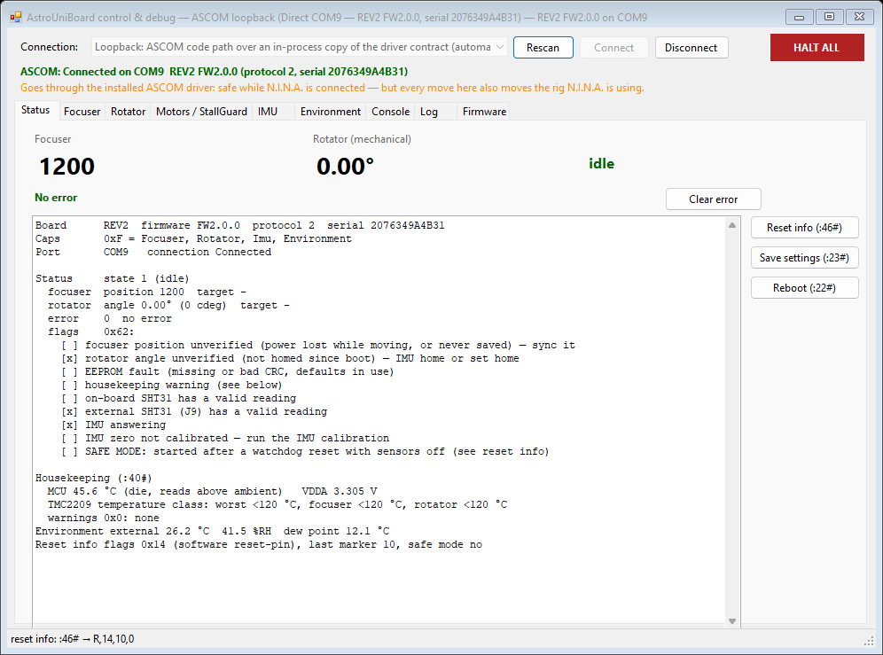

# AstroUniBoard control & debug app (#45)

WinForms, net48, no extra assemblies: `AstroUniBoard.DebugApp.exe` + `AstroUniBoard.Core.dll`.
JSON comes from `System.Web.Extensions` (`JavaScriptSerializer`), which is part of .NET Framework 4.8,
so the installer has nothing extra to ship for the app itself. The installer also puts `dfu-util.exe`
next to it for the firmware update (see Firmware).

## Connection

| Choice | How | When |
|---|---|---|
| **ASCOM driver** (default) | late-bound COM to `ASCOM.AstroUniBoard.Focuser`, only the `AstroUniBoard:*` Action contract below | on the rig: works while N.I.N.A. is connected to the same LocalServer |
| **Direct** (automatic or a COM port) | its own `BoardController` on the port | bench work, no driver installed. Takes the port: N.I.N.A. cannot connect meanwhile |
| Loopback (`--loopback`) | the ASCOM code path over an in-process copy of the contract (`LoopbackDriver.cs`) | development, before the LocalServer is installed |

Both go through `IBoardSession` (`Sessions.cs`). Moves use raw commands (`:51 :52 :71 :72`), so they
behave the same on both paths; per-axis halts are `:53#`/`:73#` (direct: the controller's urgent halt),
**HALT ALL** is `AstroUniBoard:HaltAll`.

### Action contract used (the LocalServer implements it)

| Action | Param | Returns |
|---|---|---|
| `AstroUniBoard:Raw` | `:NN...#` | reply without `#` (`OK`, `ERR,7`, `S,1,...`) or `ERROR: <message>` |
| `AstroUniBoard:Snapshot` | — | JSON: `connection`, `port`, `problem`, `identity`, `status`, `housekeeping`, `environment`, `focuser`, `rotator` (Core property names; keys case-insensitive, enums as int or name) |
| `AstroUniBoard:Log` | last seen seq or empty | JSON `[{"seq":12,"time":"2026-11-06T13:30:01.123Z","text":"..."}]` |
| `AstroUniBoard:HaltAll` `:ClearError` `:SaveSettings` `:ImuHome` `:ImuCalibrate` `:Reboot` `:EnterDfu` | — | `OK` / `ERROR: <message>` |

`LoopbackDriver.cs` is the reference implementation; `SnapshotJson.Build` makes the snapshot object.
On connect the app checks that `SupportedActions` contains `AstroUniBoard:Snapshot`.

## Tabs

| Tab | What |
|---|---|
| Status | positions, state, error with text + Clear, decoded flags, housekeeping `:40#`, reset info `:46#`, Save `:23#`, Reboot `:22#` |
| Focuser | jog ±10/100/1000 or any, absolute move, halt, sync `:56`; settings `:54..:67` edit + Apply, Save, Defaults `:24#` |
| Rotator | jog ±0.1/1/10/90° or any, mechanical angle `:71`, go home, IMU home `:77#`, halt, sync `:76`, set home `:76,0#`; settings incl. cable wrap `:75` |
| Motors / StallGuard | TMC2209 config `:47`/`:48` per axis; StallGuard `:41` with suggested threshold, set `:42` |
| IMU | live `:94#`, stored calibration `:96#`, IMU home, guided zero calibration `:95#` with pre-checks (IMU answering, tilt, cable wrap headroom, idle) and result |
| Environment | `:90#`, both SHT31 `:91#` with status decoded, sensor selection `:92#`/`:93` |
| Console | raw commands, history (Up/Down), `ERR,n` explained, structured replies decoded; every command any tab sends is echoed |
| Log | driver log (or the Core log, direct) + what the app sent; export to a text file |
| Firmware | DFU update: image check (below), halt a moving axis (asks first, #76), no other bootloader present, `:31#`, wait for `0483:df11`, `dfu-util -d 0483:df11 -a 0 -s 0x08000000:leave -D <bin>`, reconnect, compare firmware/serial — the flow of `fw-onstepx/tools/firmware_manager` (PR #62). "Only enter DFU" for other tools |

Image check before `:31#` (#79):
- a `.bin` of at most 128 KB;
- the vector table: word 0 (initial SP) in SRAM `0x20000001–0x20024000`, word 1 (reset vector)
  odd and inside the flash `0x08000000–0x08020000` and inside the image (catches truncated files);
- the marker `ASTROUNIBOARD-IMG:<model>;` the firmware embeds (`ASTROUNIBOARD-IMG:REV2;`), compared
  with the model of the identify reply. No marker (images built before it): a warning you must
  confirm. Another model: not flashed unless you force it (two confirmations).

dfu-util: the copy installed next to the exe is used without asking. Otherwise the app finds one on
`PATH` (absolute entries only), then in `~/.platformio/packages/tool-dfuutil/bin`, and asks once
before it uses that copy or one you typed in (a copy you pick with Browse counts as your OK). The
full path used is logged. The installer ships dfu-util 0.11 (`dfu-util.exe`, `libusb-1.0.dll`; GPL-2.0
and LGPL-2.1, licence and source links in `dfu-util-COPYING.txt` / `dfu-util-SOURCE.txt`). The STM32
bootloader needs the WinUSB driver once (Zadig).

## Command line

```
AstroUniBoard.DebugApp.exe [--port COM9] [--connect] [--tab imu] [--loopback] [--screenshots <folder>]
```

`--tab` opens on a tab by the first word of its title (`status`, `focuser`, `rotator`, `motors`, `imu`,
`environment`, `console`, `log`, `firmware`). The driver's Setup dialog starts the app with
`--connect --tab imu` for the IMU calibration, so the installer must put `AstroUniBoard.DebugApp.exe`
next to `AstroUniBoard.Ascom.Server.exe`.
`--screenshots` connects, saves a PNG of every tab and exits (used for the docs).

## Tests

`AstroUniBoard.DebugApp.Tests`: snapshot JSON parsing, the ASCOM path against a fake driver and
against the loopback over Core's in-memory `FakeBoard` (with an OpenWheel on the shared PID that must
be skipped). Hardware tests run only with `ASTROUNIBOARD_PORT=COM9` (or `auto`): small focuser and
rotator moves on both paths; `ASTROUNIBOARD_DFU_IMAGE=<bin>` additionally flashes that image.
`ASTROUNIBOARD_ASCOM=1` checks the installed LocalServer read-only (no moves) next to any other
connected client, and that closing the app leaves that client connected.
`ASTROUNIBOARD_ASCOM=moves` (no other client): small moves, a halted focuser move and IMU home through
the installed driver.

```
dotnet test driver/ASCOM/AstroUniBoard.sln
```


